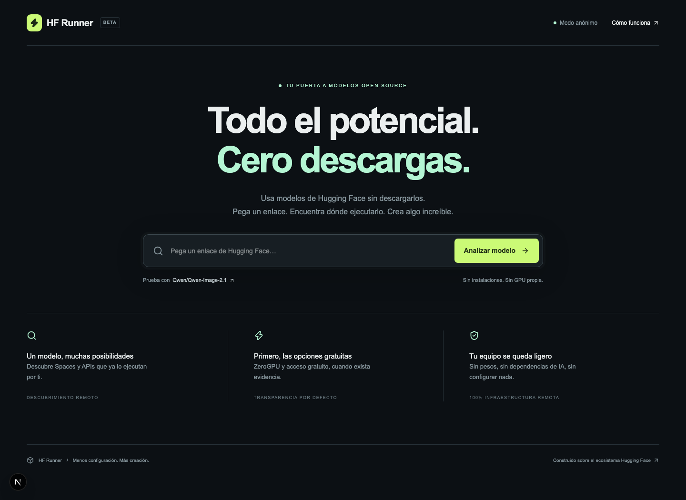
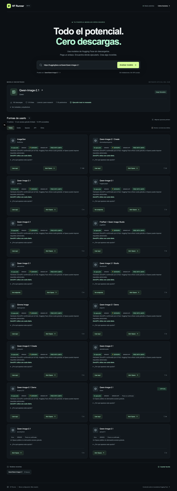
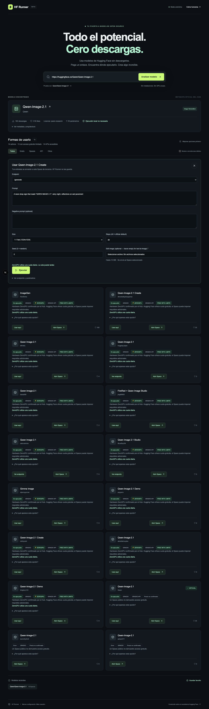

# HF Runner

**Usa modelos de Hugging Face sin descargarlos.** Pega una URL o `autor/modelo`, descubre Spaces y proveedores, compara su disponibilidad y utiliza APIs Gradio compatibles desde una interfaz generada automáticamente.

## Galería

<table>
<tr>
<td align="center" valign="top"><br><sub>Inicio y búsqueda de modelos</sub></td>
<td align="center" valign="top"><br><sub>Resultados de descubrimiento</sub></td>
</tr>
<tr>
<td align="center" valign="top"><br><sub>Formulario del ejecutor</sub></td>
</tr>
</table>

Next.js 16 · React 19 · TypeScript · Tailwind CSS 4. Sin Python, base de datos ni runtime de modelos.

## Arranque

Necesitas Node.js 22.13 o posterior.

```sh
cd hf-runner
npm ci
cp .env.example .env.local
npm run dev
```

Abre http://localhost:3000. Si el puerto está ocupado: `npm run dev -- --port 3210`.

```sh
npm test
npm run lint
npm run build
npm start
```

Para las pruebas opcionales de navegador, arranca el servidor en 3210 y ejecuta `node tests/browser.mjs`. El script usa Google Chrome instalado en la ruta estándar de macOS; adapta `executablePath` para otro sistema. La prueba consulta metadata real y **no genera imágenes ni consume una inferencia**. 

## Variables

| Variable | Uso |
| --- | --- |
| `HF_TOKEN` | Opcional. Token de permisos mínimos, solo en el servidor. Vacío permite modo anónimo. |
| `HF_API_BASE` | `https://huggingface.co`. Otros orígenes están bloqueados por la allowlist inicial. |

No uses tokens publicados en chats. No incluyas secretos en código, variables `NEXT_PUBLIC_*`, localStorage o commits. La interfaz indica la presencia de configuración; no constituye una validación de identidad del token. OAuth queda para una fase futura.

## Flujo y arquitectura

```text
src/
  app/
    api/analyze/route.ts          POST JSON o SSE de descubrimiento
    api/spaces/run/route.ts       POST de ejecución remota
    api/spaces/upload/route.ts    POST multipart, hasta 10 MB
    model/[author]/[model]/       Detalle compartible
    page.tsx                     Portada
  components/
    runner.tsx                   Búsqueda y progreso
    options.tsx                  Ranking, filtros y evidencia
    executor.tsx                 Formularios y resultados
    history.tsx                  Recientes y favoritos
  lib/
    sources/                     Interfaces y adaptadores Hugging Face
    server/                      Transporte, cache, seguridad y ejecución
    parse.ts                     Normalización de repo_id
    tasks.ts                     Clasificación extensible
    gradio.ts                    Normalización de schemas
    ranking.ts                   Pesos configurables
    types.ts                     Contratos compartidos
    history.ts                   Persistencia pública mínima
    sse.ts                       Eventos
 tests/                          Fixtures y pruebas sin red
 docs/                           Evidencias de verificación y capturas
```

`ModelSource`, `SpaceSource` e `InferenceSource` separan el dominio de las integraciones. `HuggingFaceHubSource`, `HuggingFaceSpaceSource`, `HuggingFaceInferenceSource` y `HuggingFaceScraperFallback` implementan el MVP. Cache, uploads temporales y rate limits están en memoria y pueden sustituirse por adaptadores compartidos antes de desplegar varias réplicas.

### Descubrimiento

1. Valida `https://huggingface.co/autor/modelo`, `huggingface.co/autor/modelo` o `autor/modelo`.
2. Consulta `/api/models/{id}`: tarea, tags, licencia, parámetros cuando están declarados, configuración y metadata de la tarjeta. Nunca deduce tamaño del nombre.
3. Consulta `expand=inferenceProviderMapping` e `expand=inference`.
4. Busca `/api/spaces?models={id}`, búsquedas por ID, nombre y autor; agrega asociaciones publicadas por el modelo y deduplica.
5. Si faltan resultados, busca por tags y enlaces del README. HTML público solo como último fallback. No interpreta ni ejecuta instrucciones de documentos de terceros.
6. Comprueba HTTP con concurrencia 4 y timeout; los resultados aparecen progresivamente por SSE. Revisa `/gradio_api/info`, con fallback `/info`; consulta `agents.md` si no hay schema.
7. Ordena según evidencia de ZeroGPU, API accesible, disponibilidad, autor, likes y fecha. Opciones gratuitas activas primero; coincidencias LOW ocultas por defecto.

Límites explícitos: 30 resultados por consulta, hasta 40 Spaces enriquecidos; no es una enumeración exhaustiva de todo Hugging Face. EXACT: declara el modelo. HIGH: README referencia el ID. MEDIUM: coincidencia de nombre/tags. LOW: textual débil. Una coincidencia no garantiza que todos los endpoints ejecuten ese modelo: algunos Spaces son multimodelo.

### Spaces, precios y ZeroGPU

Ser público **no significa ser gratuito**. Los costes desconocidos se muestran como UNKNOWN. Para ZeroGPU, la evidencia es `runtime.hardware.current` con prefijo `zero-`, junto con la política oficial de acceso gratuito con cuotas. Un hardware solicitado o un nombre parecido no bastan. El badge FREE WITH LIMITS se refiere a la cuota de infraestructura ZeroGPU; la aplicación del Space puede imponer requisitos adicionales.

El runtime distingue RUNNING, SLEEPING, BUILDING, ERROR, STOPPED y UNKNOWN. Dormir no equivale a estar caído. La salud HTTP no garantiza una inferencia exitosa. El ranking es editable en `src/lib/ranking.ts`.

### Providers

El mapeo oficial aporta proveedor, ID, tarea y estado. Si aparecen precios, `is_free` o capacidades se preservan en `details`. FREE exige `is_free=true`; valores ausentes producen UNKNOWN. No se consultan APIs fuera de la allowlist, incluyendo el Router en `router.huggingface.co`. Por ello, precios o métricas que solo publique ese servicio no se enriquecen en este MVP. El botón abre el modelo en Hugging Face con el proveedor seleccionado; no implementa facturación ni ejecución directa de Providers.

### Ejecutor Gradio

Solo se ejecuta tras pulsar **Ejecutar**. El backend vuelve a obtener el Space desde el Hub y su schema; reconstruye host y ruta. No acepta una URL de destino.

Componentes compatibles: Textbox, Number, Slider, Checkbox, Dropdown/Radio simples e Image/File/Audio/Video individuales. Sliders usan los límites del schema; si faltan, se ofrece entrada numérica. Componentes compuestos, listas de archivos, chat con estado complejo o schemas desconocidos requieren abrir el Space o consultar sus endpoints.

Se utiliza el protocolo documentado `POST {base}/call/{api_name}` con `data`, seguido de `GET {base}/call/{api_name}/{event_id}` (SSE). El prefijo se descubre mediante el endpoint de info. La API moderna mantiene esta ruta posicional además de `/call/v2`; no se ejecutan snippets remotos. El timeout total del trabajo es aproximadamente 135 segundos. El backend recoge los eventos hasta el resultado final; no emite tokens de generación en tiempo real al navegador.

Los archivos se envían a `{base}/upload`. El servidor guarda solo una referencia opaca ligada al Space durante diez minutos, nunca archivos en disco. Soporta imágenes habituales, audio, video, PDF, TXT, CSV y JSON, hasta 10 MB. El navegador no puede suministrar paths ni URLs de archivo arbitrarias. Los archivos permanecen sujetos a la política de retención del Space remoto.

Si se configura `HF_TOKEN`, se envía server-side al host del Space confirmado por el Hub para autenticación/cuota, según documentación oficial. No se reenvía a un origen distinto durante redirects ni se inyecta como parámetro OAuth a código de aplicaciones. Un Space que exija login OAuth interactivo puede requerir abrir su interfaz. Cuotas agotadas generan un mensaje breve. No hay promesa de uso ilimitado ni de éxito en todas las APIs.

Resultados: texto escapado, JSON y medios del mismo origen del Space. No se renderiza HTML remoto ni se usa el optimizador de imágenes de Next como proxy. URLs de salida en otros dominios se muestran como datos, no se descargan por el servidor.

## APIs

```http
POST /api/analyze
Content-Type: application/json

{"input":"Qwen/Qwen-Image-2.1"}
```

Devuelve `model`, `spaces`, `providers`, `summary`, `warnings`, `connected`. Para progreso, añade `Accept: text/event-stream`: eventos `progress`, `snapshot`, `space`, `complete`, `error`.

```http
POST /api/spaces/run
Content-Type: application/json

{"space_id":"autor/space","endpoint":"/endpoint_descubierto","parameters":["texto",1024]}
```

`POST /api/spaces/upload`: multipart con `space_id` y `file`. Devuelve `upload_id`, que se usa como `{ "upload_id": "..." }` en el parámetro del archivo.

## Seguridad y límites operativos

- Solo HTTPS a `huggingface.co` y subdominios directos `*.hf.space`, sin credenciales ni puertos alternativos en URLs.
- Verificación DNS en el momento de conectar, con la IP validada utilizada por la conexión. Rechazo de IPs privadas, loopback, link-local, reservadas e IPv4 mapeada en IPv6.
- Máximo 3 redirects, revalidados en cada salto; no reenvío de uploads/POST entre orígenes.
- Respuestas limitadas en bytes; timeouts; extensiones de pesos bloqueadas. Solo metadata, README, HTML limitado y endpoints Gradio.
- Sin `eval`, clones, instalaciones de requirements, ejecución de repositorios, PyTorch, Transformers o Diffusers.
- Validación de schema y parámetros en backend; no proxy HTTP abierto; protección de origen para ejecución y subida.
- Límite global por proceso/minuto: 20 análisis, 8 ejecuciones, 10 uploads. No confía en `X-Forwarded-For` controlable por clientes.
- Cache: modelos/proveedores 10 min, Spaces/schemas 5 min, salud 90 s; máximo 500 entradas y coalescencia de solicitudes idénticas.
- Errores HTTP 429 leen Retry-After y el tiempo de reinicio de RateLimit cuando está presente.
- Logs JSON con repo/Space, latencia y estado, sin prompts, tokens, cabeceras o archivos.
- localStorage guarda solo IDs públicos, fecha y resumen para recientes; favoritos guarda únicamente IDs. Puede limpiarse desde el navegador.

**Instancia personal**, enlazada a localhost por defecto. Antes de publicarla con credenciales añade autenticación de usuarios, rate limiting compartido y controles del perímetro. Las cuotas del token configurado serían compartidas por todos los visitantes. En serverless, ajusta los límites de duración/cuerpo y usa almacenamiento compartido de referencias de upload; el MVP presupone un proceso Node persistente. No se ha desplegado públicamente.

## Verificación

Las fases se implementaron incrementalmente, desde parser/metadata hasta ejecución, uploads e historial. Tests unitarios y de integración con fixtures cubren parsing, tasks, deduplicación, precios, ZeroGPU, ranking, schemas, SSRF, redirects, límites HTTP, ejecución SSE, cuota y referencias de upload. Ningún test de la suite `npm test` necesita Hugging Face.

La prueba de descubrimiento real de `Qwen/Qwen-Image-2.1` está en `docs/real-analysis.json`. Los resultados son una fotografía temporal, no una garantía de disponibilidad futura. La prueba de navegador comprueba el análisis real, formulario generado, favoritos y layout móvil. La generación y los uploads completos se validan mediante mocks; no se afirma haber completado una generación real de imagen ni verificado un token personal.

## Documentación oficial consultada

- [Hub API](https://huggingface.co/docs/hub/api) y [OpenAPI](https://huggingface.co/.well-known/openapi.json)
- [HfApi: model_info, list_spaces, space_info](https://huggingface.co/docs/huggingface_hub/package_reference/hf_api)
- [Implementación oficial HTTP](https://github.com/huggingface/huggingface_hub/blob/main/src/huggingface_hub/hf_api.py)
- [Inference Providers Hub API](https://huggingface.co/docs/inference-providers/hub-api)
- [ZeroGPU](https://huggingface.co/docs/hub/spaces-zerogpu)
- [Spaces como herramientas: info, agentes, uploads y llamadas](https://huggingface.co/docs/hub/spaces-agents)
- [Rutas actuales de Gradio](https://github.com/gradio-app/gradio/blob/main/gradio/routes.py)

Consultadas el 20 de septiembre de 2026. Las integraciones no dependen de scraping como fuente primaria.
